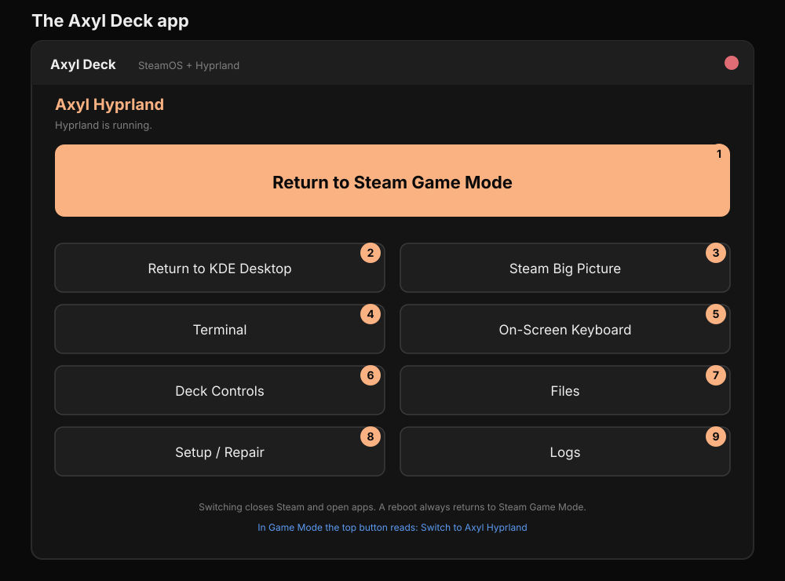
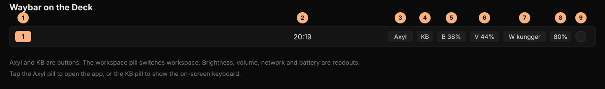
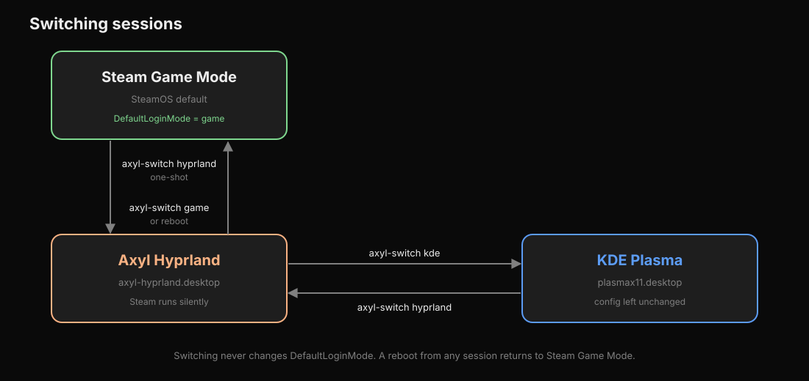
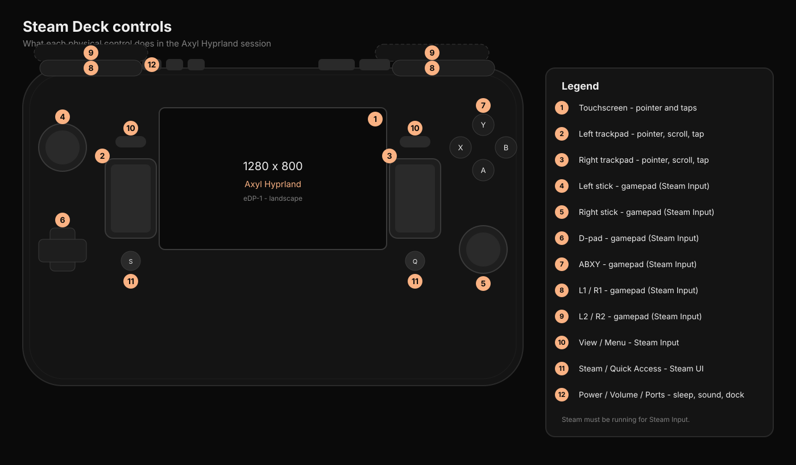

# Axyl Deck — visual guide

A picture-first guide to the buttons you tap on the Deck and what they do.
Everything here runs inside the **Axyl Hyprland** session; nothing changes Game
Mode or KDE.

---

## 1. Open the Axyl Deck app

Four ways, all equivalent:

| Where | How |
|---|---|
| Waybar | Tap **Axyl** in the top-right of the bar |
| Launcher | `SUPER + D`, then type **Axyl Deck** |
| Desktop | Double-tap the **Axyl Deck** icon |
| Terminal | `axyl-switch` |

The app is a floating window, so it never tiles over your work.

---

## 2. The app buttons

The **top button changes with the session**:

- In Hyprland it reads **Return to Steam Game Mode**.
- In Game Mode or KDE it reads **Switch to Axyl Hyprland**.

| # | Button | What it does |
|---|---|---|
| 1 | **Return to Steam Game Mode** / **Switch to Axyl Hyprland** | One-shot session switch. Closes Steam and open apps. A reboot still returns to Game Mode. |
| 2 | **Return to KDE Desktop** | Switches to the stock KDE Plasma session. Only shown while in Hyprland. |
| 3 | **Steam Big Picture** | Opens Steam in Big Picture mode. |
| 4 | **Terminal** | Opens Foot. |
| 5 | **On-Screen Keyboard** | Shows or hides the squeekboard keyboard. |
| 6 | **Deck Controls** | Opens TDP, brightness, volume, governor and fan controls. |
| 7 | **Files** | Opens Dolphin. |
| 8 | **Setup / Repair** | Re-applies packages, the session entry and config. Asks for admin approval. Use after a SteamOS update. |
| 9 | **Logs** | Shows the switch and session logs. |

The status line above the buttons names the current session and says whether
Hyprland is ready.

---

## 3. The Waybar

| # | Module | Tap action |
|---|---|---|
| 1 | Workspace **1** | Switch to that workspace |
| 2 | **20:19** (clock) | Hover for the date |
| 3 | **Axyl** | Open the Axyl Deck app |
| 4 | **KB** | Toggle the on-screen keyboard |
| 5 | **B 38%** | Brightness readout |
| 6 | **V 44%** | Volume readout |
| 7 | **W kungger** | Network readout (hover for IP and signal) |
| 8 | **80%** | Battery readout (hover for time left) |
| 9 | Tray | App icons |

Only **Axyl** and **KB** are buttons. Brightness, volume, network and battery are
readouts; change them from the **Deck Controls** window or the hardware keys.

---

## 4. Switching sessions

- **Game Mode is the default.** `DefaultLoginMode` is never changed.
- **Switch to Hyprland:** app button, or `axyl-switch hyprland`.
- **Return to Game Mode:** app button, `axyl-switch game`, `SUPER + SHIFT + Escape`,
  or a reboot.
- **KDE** stays available through **Return to KDE Desktop** (or `axyl-switch kde`).

The switch is one-shot: a crash or power cycle always lands in Game Mode.

---

## 5. Physical controls

| # | Control | What it does |
|---|---|---|
| 1 | Touchscreen | Pointer and taps (mapped to the internal panel) |
| 2 | Left trackpad | Pointer, scroll, tap-to-click |
| 3 | Right trackpad | Pointer, scroll, tap-to-click |
| 4 | Left stick | Gamepad input through Steam Input |
| 5 | Right stick | Gamepad input through Steam Input |
| 6 | D-pad | Gamepad input through Steam Input |
| 7 | A / B / X / Y | Gamepad input through Steam Input |
| 8 | L1 / R1 | Gamepad input through Steam Input |
| 9 | L2 / R2 | Gamepad input through Steam Input |
| 10 | View / Menu | Steam Input |
| 11 | Steam / Quick Access | Steam UI |
| 12 | Power / Volume / Ports | Sleep, hardware volume, dock and headphones |

Steam starts silently in Hyprland. **Steam must be running** for the buttons and
sticks to reach apps through Steam Input. The touchscreen and trackpads drive the
pointer directly.

To use the desktop with only the Deck controls, set up Steam Input's desktop
layout in **Steam → Settings → Controller**. The on-screen keyboard is the
reliable way to type.

---

## 6. Quick answers

| I want to… | Do this |
|---|---|
| Leave Hyprland and play a game | **Return to Steam Game Mode**, or `SUPER + SHIFT + Escape` |
| Go back to KDE | **Return to KDE Desktop** |
| Open a terminal | **Terminal**, or `SUPER + Return` |
| Launch an app | `SUPER + D` (Rofi), or tap **Axyl** then a button |
| Type without a keyboard | **KB** in Waybar, or `SUPER + SHIFT + K` |
| Change TDP / fan / brightness | **Deck Controls** |
| Fix things after a SteamOS update | **Setup / Repair** |
| See what went wrong | **Logs** |

---

## 7. If something goes wrong

- **Stuck in Hyprland:** press `SUPER + SHIFT + Escape`, or hold the power button
  to power off. A reboot returns to Game Mode.
- **Session missing after a SteamOS update:** open **Axyl Deck** → **Setup / Repair**,
  or run `steamdeck/install.sh --repair`.
- **On-screen keyboard blank:** the layout file is missing; re-run **Setup / Repair**.
- **Lock screen:** intentionally disabled. `SUPER + L` explains why; use the power
  button to sleep instead.

---

## 8. Keyboard shortcuts

These need a keyboard (docked, Bluetooth, or a Steam Input desktop mapping).
They are the shared Axyl binds.

| Keys | Action |
|---|---|
| `SUPER + Return` | Foot terminal |
| `SUPER + D` | Rofi launcher |
| `SUPER + A` | Window switcher |
| `SUPER + W` | Steam Big Picture |
| `SUPER + E` | Dolphin |
| `SUPER + Q` | Close window |
| `SUPER + SHIFT + K` | On-screen keyboard |
| `SUPER + SHIFT + Escape` | Return to Game Mode |
| `SUPER + SHIFT + Q` | Power menu |
| `SUPER + /` | Keybind cheat sheet |
| `SUPER + 1…0` | Workspaces |
| `SUPER + F` | Fullscreen |
| `SUPER + V` | Toggle floating |

The full set is in `skel/.config/hypr/conf/keybinds.lua`.
